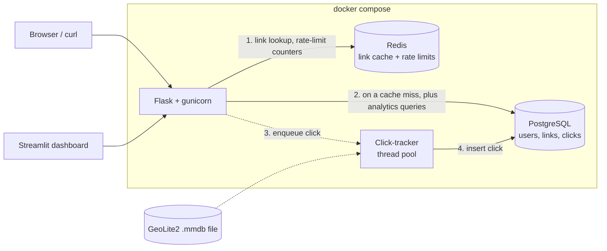
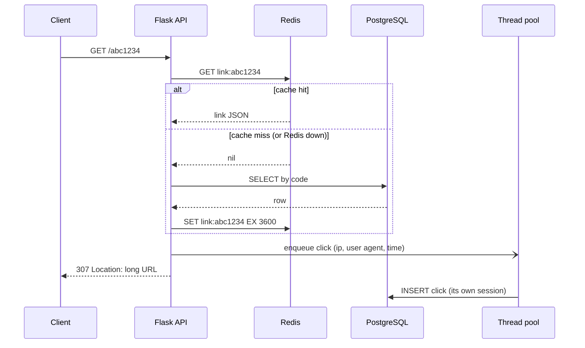

# Shortly: a URL shortener with click analytics

A Bitly-style service: create short links, redirect fast, and see who clicked (country, device, browser, OS).
Built with **Flask**, **SQLAlchemy 2.0**, **PostgreSQL**, **Redis**, JWT auth, and a **Streamlit** dashboard.

## Features

- Signup / login with JWT (bcrypt-hashed passwords)
- Create short links (authenticated): random 7-character code or custom alias, optional expiry, URL validation
  (rejects invalid URLs and links pointing back at the service)
- `GET /<code>` redirects with **HTTP 307**: Redis first (TTL 1 hour), PostgreSQL on a miss, 404 if missing or expired
- Click tracking in the background (timestamp, country, device, browser, OS), so redirects stay fast
- Owner-only analytics: total clicks, by country, by device, per day, top links
- Redis rate limiting: 20 link creations per minute per IP, then `429` with `Retry-After`
- Streamlit dashboard: login, your links, country bar chart, device pie chart, clicks-per-day line chart
- `pytest` suite, GitHub Actions CI (SQLite + PostgreSQL), Docker, locust benchmark

## Web interface

Open **http://localhost:5000** (the home page of the same Flask app):

- create an account or log in
- paste a URL, optionally set a custom alias and an expiry, and get your short link (with a Copy button)
- see all your links with click counts
- press **Stats** on a link for total clicks, clicks by country and device, and a clicks-per-day chart

It is a single static page (`app/static/index.html`, plain HTML/CSS/JS, no build step) that calls the JSON API below.
The Streamlit dashboard is a separate, optional view of the same data.

## Architecture



What happens on a redirect:



## Quick start on Windows (no Docker)

Requires Python 3.12 (3.11+ works; **avoid 3.13+**, where `passlib` breaks).

1. Double-click **`start.bat`**. It creates a virtual environment, installs packages, writes a `.env` with a random
   `SECRET_KEY` and a local SQLite database, applies migrations, and starts the server at http://localhost:5000.
2. In a second window try it: `try_api.bat`, `try_redirect.bat`, `try_analytics.bat`, `try_ratelimit.bat`.
3. Run the tests: `test.bat`.

Without Redis the app still works: redirects read the database and rate limiting uses in-memory counters.

## Quick start with Docker (API + PostgreSQL + Redis)

Requires Docker Desktop. No setup file is needed:

```bash
docker compose up
```

(or double-click `docker-start.bat`, which also opens the health page). The first run builds the image.
The web page and API are then at http://localhost:5000. Migrations run automatically on start.

- Without a `.env`, development defaults are used and a temporary `SECRET_KEY` is generated (logins reset when
  the container restarts). For anything real, copy `.env.example` to `.env` and set `SECRET_KEY` and `POSTGRES_PASSWORD`.
- Optional country detection: download the free **GeoLite2 Country** database from MaxMind and save it as
  `data/GeoLite2-Country.mmdb`. Without it, country is stored as `Unknown`.
- Stop with `docker-stop.bat` (data is kept) or `docker compose down -v` (deletes the database as well).
- Dashboard: `docker compose --profile dashboard up -d`, then open http://localhost:8501.
  Without Docker on Windows: run `start.bat`, then double-click `dashboard.bat`. To fill an empty database with realistic
  demo clicks so the charts have something to show, double-click `seed_demo.bat`. Manually: `pip install -r dashboard/requirements.txt`,
  then `streamlit run dashboard/app.py`
  (set `API_URL` if the API is not on `http://localhost:5000`).

## Configuration

Everything comes from environment variables (or `.env`); see `.env.example`. Required: `DATABASE_URL`, `REDIS_URL`, `SECRET_KEY`.

| Variable | Default | Meaning |
|---|---|---|
| `BASE_URL` | `http://localhost:5000` | Prefix of returned `short_url`s; its host can't be shortened |
| `BLOCKED_HOSTS` | `localhost,127.0.0.1` | Extra hosts that links may not point to |
| `ACCESS_TOKEN_EXPIRE_MINUTES` | `60` | JWT lifetime |
| `SHORT_CODE_LENGTH` | `7` | Length of random codes |
| `CACHE_ENABLED` / `CACHE_TTL_SECONDS` | `true` / `3600` | Redis redirect cache |
| `RATE_LIMIT_ENABLED` / `RATE_LIMIT_REQUESTS` / `RATE_LIMIT_WINDOW_SECONDS` | `true` / `20` / `60` | Link-creation limit per IP |
| `TRUSTED_PROXY_COUNT` | `0` | Reverse proxies in front of the app (so rate limits see real client IPs) |
| `GEOIP_DB_PATH` | `data/GeoLite2-Country.mmdb` | Optional MaxMind country database |

## API

| Method and path | Auth | Result |
|---|---|---|
| `POST /api/auth/signup` | no | 201 user, 409 email taken, 422 invalid |
| `POST /api/auth/login` | no | 200 `{access_token, token_type, expires_in}`, 401 wrong credentials |
| `POST /api/links` | yes | 201 link, 409 alias taken, 422 invalid URL/alias/expiry, 429 rate limited |
| `GET /api/links` | yes | your links, newest first (`limit`, `offset`) |
| `GET /<code>` | no | 307 redirect, 404 missing or expired (a trailing `/` is tolerated) |
| `GET /api/analytics/links/<code>/total` | owner | total clicks |
| `GET /api/analytics/links/<code>/by-country` | owner | clicks per country |
| `GET /api/analytics/links/<code>/by-device` | owner | clicks per device |
| `GET /api/analytics/links/<code>/per-day?days=30` | owner | clicks per UTC day (1 to 365), zero-filled |
| `GET /api/analytics/top-links?limit=10` | yes | your links ranked by clicks |
| `GET /` | no | the web interface |
| `GET /health` | no | `{"status": "ok"}` |

Analytics: 401 not logged in, 403 someone else's link, 404 no such link. Errors are JSON: `{"error": "...", "details": [...]}`.

### curl examples (macOS / Linux / Git Bash; needs `jq` for the token line)

```bash
curl -X POST http://localhost:5000/api/auth/signup \
  -H "Content-Type: application/json" \
  -d '{"email":"me@example.com","password":"password123"}'

TOKEN=$(curl -s -X POST http://localhost:5000/api/auth/login \
  -H "Content-Type: application/json" \
  -d '{"email":"me@example.com","password":"password123"}' | jq -r .access_token)

curl -X POST http://localhost:5000/api/links \
  -H "Authorization: Bearer $TOKEN" -H "Content-Type: application/json" \
  -d '{"long_url":"https://example.com/some/long/page","custom_alias":"my-link","expires_at":"2030-01-01T00:00:00Z"}'

curl -i http://localhost:5000/my-link                    # 307 + Location header
curl -H "Authorization: Bearer $TOKEN" http://localhost:5000/api/analytics/links/my-link/total
curl -H "Authorization: Bearer $TOKEN" "http://localhost:5000/api/analytics/links/my-link/per-day?days=7"
curl -H "Authorization: Bearer $TOKEN" http://localhost:5000/api/analytics/top-links
```

Windows `cmd` needs escaped quotes, for example:

```bat
curl -X POST http://localhost:5000/api/auth/signup -H "Content-Type: application/json" -d "{\"email\":\"me@example.com\",\"password\":\"password123\"}"
```

(The `try_*.bat` scripts avoid the quoting problem entirely.)

## Design decisions

**Why 307 and not 301.** A 301 is "moved permanently": browsers and proxies cache it, so repeat visits would never reach
the server again. Clicks would go uncounted, and a link that was edited, expired or deleted would keep redirecting.
A 307 is a temporary redirect that keeps the method and is not cached by default (we also send `Cache-Control: no-store`),
so every click passes through the service. The cost is a little more traffic; the benefit is correct analytics and expiry.

**Why click logging runs in the background.** Redirect latency is what users feel, and a click row is a database
write. Writing it inside the request would add a round trip to every redirect and tie redirect availability to write
availability. Instead the request captures plain values (IP, user agent, time), hands them to a thread pool, and returns.
The worker uses its own database session, never raises into the request, and the queue is bounded (10,000 events,
dropped with a warning beyond that). The trade-off is that a crash can lose in-flight clicks; the Celery/Kafka item below removes that.

**Why Redis.** Redirects are read-heavy and each one only needs `(link id, long URL, expiry)`. Redis answers that from
memory without touching PostgreSQL, which keeps the database free for writes and analytics. Entries live for at most one
hour and never beyond the link's own expiry. The same Redis holds the rate-limit counters, so every API instance sees the
same numbers. Redis is an optimisation, not a dependency: if it is down, redirects fall back to PostgreSQL and rate limiting
to per-process counters, with a circuit breaker so a dead Redis doesn't add a timeout to every request.

**Other choices worth knowing**
- *Unique codes come from the database.* Codes are random (`secrets`), and the unique index is the source of truth; an
  `IntegrityError` triggers a retry. A "check then insert" would race under concurrency.
- *Fixed-window rate limiting.* Simple and cheap (one `INCR`), but a client can send up to 2x the limit around a window
  boundary. A sliding window would fix that.
- *Rate limit is checked before authentication,* so unauthenticated hammering is throttled too. The client IP is taken from
  the connection; `X-Forwarded-For` is only trusted if `TRUSTED_PROXY_COUNT` says how many proxies to expect.
- *Analytics aggregate in SQL* (`GROUP BY`), per-day buckets use the UTC day, and days without clicks are returned as 0.
- *403 vs 404 on analytics:* a link you don't own gives 403, a missing one 404. Short codes are public anyway.

## Tests and CI

`test.bat` (or `python -m pytest`) runs the suite: auth, link creation, redirect, expiry, rate limiting, analytics access
control, cache, tracker. Each test gets a fresh database and a fake Redis. GitHub Actions
(`.github/workflows/ci.yml`) runs it on every push on SQLite, and again against a real PostgreSQL service
(plus a migration upgrade/downgrade round trip).

## Benchmark

`benchmark.bat` runs locust twice against the Docker stack (50 users, 30 s each): once with the Redis cache and once with
`CACHE_ENABLED=false`, then prints a table and saves `benchmark_results/summary.md`. By hand:

```bash
CACHE_ENABLED=true  docker compose up -d --force-recreate --wait api && BENCH_LABEL=with_redis    docker compose --profile bench run --rm locust
CACHE_ENABLED=false docker compose up -d --force-recreate --wait api && BENCH_LABEL=without_redis docker compose --profile bench run --rm locust
python scripts/summarize_benchmark.py
```

Results (fill in after your run; note your CPU, RAM and `GUNICORN_WORKERS`):

| Scenario | Requests | Failures | Req/s | Median (ms) | p95 (ms) | p99 (ms) |
|---|---:|---:|---:|---:|---:|---:|
| With Redis cache | _TBD_ | _TBD_ | _TBD_ | _TBD_ | _TBD_ | _TBD_ |
| Without cache (PostgreSQL only) | _TBD_ | _TBD_ | _TBD_ | _TBD_ | _TBD_ | _TBD_ |

Keep in mind that both runs also write a click row per redirect, and the benchmark client shares your machine with the server.

## Project structure

```
app/            main.py (app factory), config.py, database.py, models.py, schemas.py, auth.py, deps.py, errors.py
  routers/      auth.py, links.py, redirect.py, analytics.py, web.py     (Flask blueprints)
  static/       index.html (the web interface)
  services/     shortener.py, cache.py, tracker.py, rate_limiter.py, analytics.py
alembic/        migrations          dashboard/   Streamlit app (+ Dockerfile)
tests/          pytest suite        scripts/     try_*.py demos, setup helpers
Dockerfile, docker-compose.yml, docker/entrypoint.sh, locustfile.py, .github/workflows/ci.yml
start.bat, test.bat, docker-start.bat, docker-stop.bat, benchmark.bat   (Windows helpers)
```

## Troubleshooting

- *`docker compose up` can't reach the daemon:* start Docker Desktop and wait for "Engine running".
- *API can't log in to PostgreSQL after changing `POSTGRES_PASSWORD`:* the old password lives in the volume; `docker compose down -v` resets it (deletes data).
- *Port 5000 is taken:* set `API_PORT` (and `BASE_URL` to match) in `.env`.
- *Locust image tag not found:* change `locustio/locust:2.32.0` in `docker-compose.yml` to `latest`.

## Future improvements

- **Click events through a queue (Celery or Kafka).** Today an in-process thread pool can lose in-flight clicks on a crash and
  competes with the web workers. Publishing click events to Kafka (or a Celery/Redis task) and consuming them in separate workers
  adds durability, replay, and batch inserts.
- **Read replicas.** Send analytics and redirect cache-miss reads to PostgreSQL replicas; keep writes on the primary.
- Partition or roll up the `clicks` table (daily aggregates) so analytics stay fast at hundreds of millions of rows.
- Sliding-window or token-bucket rate limiting, plus limits on login and signup (brute-force protection) and per-user quotas.
- Negative caching for unknown codes, and cache invalidation on link edit/delete (endpoints not built yet).
- Link management: edit, delete, disable, QR codes, bulk create. Refresh tokens and email verification.
- Metrics (Prometheus) and structured logs; move off `passlib` (unmaintained) to `argon2-cffi` or `bcrypt` directly.
